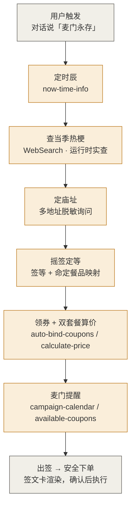
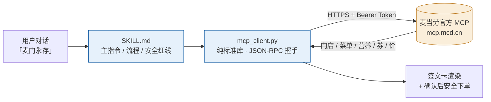

# 🏮 麦门赛博求签 (McMen Fortune)

> 基于麦当劳官方 MCP 的趣味点餐决策 Skill —— 摇电子签筒，结合官方实时数据出签文 + 命定餐品 + 今日宜忌，可一键安全下单。


---

## ✨ 亮点

- 🔥 **热梗实时**：签诗里的梗在用户触发时按当季 `WebSearch` 实查，不写死、永远新鲜，搜索失败有兜底，绝不编造。
- 🛡️ **安全合规**：领券 / 下单等写操作均经用户显式确认，绝不静默扣费；仓库不含任何真实 Token。
- 🍔 **双套餐真价**：先自动领券，再给出「到店自取 + 麦乐送外送」两套基于官方 `calculate-price` 的真实到手价。
- 📍 **多地址脱敏**：检测到多个配送地址时列出脱敏标签询问用户选哪个，绝不默认第一个；签文仅显城市·区。

---

## 🔄 核心流程



---

## 🧩 架构

Skill 不依赖任何 WorkBuddy 连接器，用纯标准库客户端直连麦当劳官方 MCP：



---

## 🎴 签文卡长啥样

> 以下为渲染形态示例（真实字段以 MCP 返回为准；签诗会融入当季热梗）：

🏮 **麦门赛博求签** · 2026-10-10 周六 · 午餐时辰
📍 庙址：成都中环路奥园广场餐厅（麦乐送外送）｜到店：双成二路万象城餐厅
🏠 送餐至：成都·成华区（地址已脱敏，不显门牌 / 手机）

**【上上签】** 今日财神递来巨无霸，双牛加芝士向你走来。贵是贵点，但吃了**不烧心**——用料实在，方为人间值得。
宜加蛋加芝士犒劳自己（**爱你老己**），忌假装不饿、忌将就、忌说「我吃饱了」。

· **到店自取版**：巨无霸 ×1 — 到店价 **¥26**
· **麦乐送外送版**：巨无霸 ×1 — 外送到手 **¥36.1**（含运费 + 打包）

📌 说「就按这个下单」，确认明细后再下单（默认不自动下单）。

---

## 🚀 快速开始

### 1. 获取 Token（关键一步）

数据来自麦当劳官方 MCP，需要你自己的 Token（代表你的会员身份）。按官方文档 `https://open.mcd.cn/mcp/doc`：

1. 打开 `https://open.mcd.cn/mcp/doc`，点击右上角 **【登录】**。
2. 跳转到登录页，**用手机号登录**（首次需阅读并同意《使用条款》《麦当劳 MCP 服务规则》）。
3. 登录后点击右上角 **【控制台】**，在弹出的控制台窗口中点 **【激活】** 按钮，申请 MCP Token。
4. 申请成功后**复制 Token**（一长串字符，切勿分享给他人）。

> ⚠️ Token 代表你的麦当劳会员身份，请勿提交到 GitHub 或泄露给他人。

### 2. 安装与配置

1. 把本目录放到用户级技能目录：

   ```
   ~/.workbuddy/skills/mcd-fortune/
   ```

2. 复制配置模板并填入 Token：

   ```bash
   cp config.example.json config.json
   # 编辑 config.json，把 mcp_token 换成你从控制台复制的真实 Token
   ```

   `config.json` 内容：

   ```json
   {
     "mcp_token": "你的麦当劳官方 MCP Token",
     "mcp_endpoint": "https://mcp.mcd.cn"
   }
   ```

   （`config.json` 已在 `.gitignore` 中，不会被提交。）

3. 在 WorkBuddy 对话中说：**「麦门永存」**（兼容「麦门求签」「摇个签」「今天吃啥求签」「麦门黄历」）。

### 3. 连通性自测

无需下单，先验证 Token 与端点是否可用：

```bash
python scripts/mcp_client.py list
python scripts/mcp_client.py schema calculate-price   # 查看参数结构
```

能列出 35 个工具名即代表配置成功。

---

## 🛡️ 安全

- 下单 / 领券 / 抽奖前强制预览明细 + 用户确认，绝不静默扣费。
- 价格 / 库存 / 限购以下单接口返回为准。
- 限流：每 Token 每分钟最多 600 次，避免高频调用。

---

## 📂 文件

- `SKILL.md` — 主指令（触发词、流程、安全红线、文案风格，给 AI 看）
- `CHANGELOG.md` — 版本与迭代记录（V0.1.0 起）
- `config.example.json` — Token 配置模板（复制为 `config.json` 后填写）
- `scripts/mcp_client.py` — 官方 MCP 直连客户端（仅标准库，自动处理握手与鉴权）
- `references/tool_catalog.md` — 官方 MCP 工具清单与配置要点
- `references/fortune_logic.md` — 签等 → 餐品映射逻辑
- `references/sample_output.md` — 输出样例（含安全下单确认态）
- `MCP_INTEGRATION.md` — 官方 MCP 接入说明（server / tools / 流程 / 价值）
- `CONTEST_DECLARATION.md` — 大赛官方声明（内容不可修改）
- `workbuddy.md` — WorkBuddy 联动奖励核验用

---

## 🏆 参赛（2026 麦当劳程序员创意开发大赛）

- 赛事官方仓库：`https://github.com/M-China/mcd-developer-innovation-challenge`
- 麦当劳官方 MCP 使用指南：`https://github.com/M-China/mcd-mcp-server`
- 本仓库已按官方要求包含必需文件：`README.md`、`CONTEST_DECLARATION.md`（内容不可修改）、`MCP_INTEGRATION.md`、源代码（`SKILL.md` + `scripts/` + `references/`），并附带 `workbuddy.md`（WorkBuddy 联动奖励核验用）。
- 安全合规：仓库不含任何真实 Token（`config.json` 已被 `.gitignore` 忽略），领券 / 下单等写操作均经用户显式确认后执行。

当前版本：V0.1.6（迭代记录见 `CHANGELOG.md`）。
